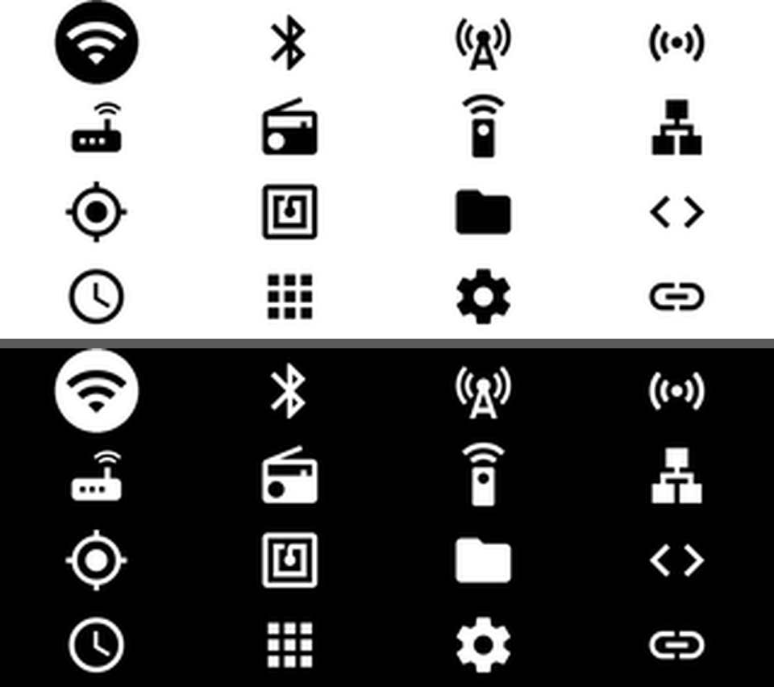
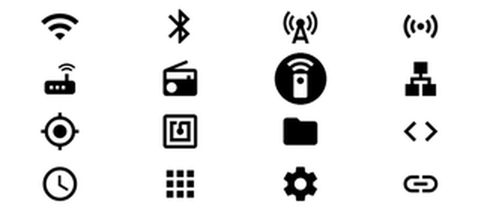
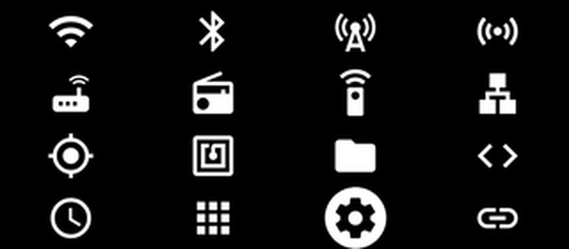
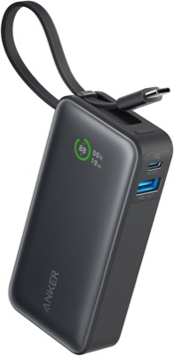

# ⬛ Grille — Bruce Theme

🇺🇸 <b>English</b> · 🇫🇷 <a href="README.fr.md">Français</a>

  

A clean, minimal **grid** UI theme for the **[Bruce firmware](https://github.com/BruceDevices/firmware)** on the LilyGO T-Embed CC1101 (320×170). All menus are shown at once as a **4×4 grid** of professional Material icons; the current menu is highlighted — inverted inside a solid circle. Light and dark variants included.

## 🎨 Two variants

| Variant | Pictos | Selection |
|---|---|---|
| **`Grille`** | black on white | **white picto in a black circle** |
| **`Grille_Dark`** | white on black | **black picto in a white circle** |

| Light | Dark |
|---|---|
|  |  |

## ✨ Details

- 🔲 **4×4 grid** = all 16 menu entries always visible.
- 🎯 Current menu **highlighted** (inverted inside a solid circle) — no text, very easy to read.
- 🧩 Google **[Material Icons](https://github.com/google/material-design-icons)** (professional style): WiFi, Bluetooth, RF, NRF, LoRa, FM, IR, Ethernet, GPS, RFID, Files, Scripts, Clock, Others, Config, Connect.

## 📦 Contents

Each variant: **4 sizes** × **16 PNGs** + `.json`.

| Folder | Image | Target screen |
|---|---|---|
| `105px/` | 240×105 | M5StickC Plus (240×135) |
| `140px/` | 320×140 | **T-Embed CC1101 / Cardputer (320×170)** |
| `180px/` | 320×180 | ~320×210 screens |
| `192px/` | 320×192 | ~320×222 screens |

> ℹ️ **Status bar** — Bruce reserves **30 px at the top**. Size = screen height − 30 → **T-Embed CC1101 = `140px`**.

## 🚀 Installation

1. Copy **`Grille`** and/or **`Grille_Dark`** to the root of the SD card.
2. On the device: **Config → UI Theme → `Grille/140px/Theme_Grille.json`** (or `Grille_Dark/140px/Theme_Grille_Dark.json`).
3. Over WiFi: **Files → WebUI**, upload the folder, then select the `.json`.

## 🛒 Hardware

*Amazon affiliate links: if you buy through these links, the project earns a small commission at no extra cost to you.*

<table>
<tr>
<td align="center" width="33%">
   
  <b><a href="https://www.amazon.com/dp/B0D45MSMJR?linkCode=ll2&amp;tag=koua29bgrilletheme-20&amp;ref_=as_li_ss_tl">Anker 545 power bank (10,000 mAh)</a></b> Keeps the T-Embed running away from an outlet
</td>
<td align="center" width="33%">
   
  <b><a href="https://www.amazon.com/dp/B0C1FCZM94?linkCode=ll2&amp;tag=koua29bgrilletheme-20&amp;ref_=as_li_ss_tl">433 MHz SMA antenna (2-pack)</a></b> Sub-GHz antenna for the CC1101 radio
</td>
<td align="center" width="33%">
   
  <b><a href="https://www.amazon.com/dp/B0B7NVMBPL?linkCode=ll2&amp;tag=koua29bgrilletheme-20&amp;ref_=as_li_ss_tl">SanDisk 64 GB microSD (2-pack)</a></b> For Bruce themes, scripts and captures
</td>
</tr>
</table>

As an Amazon Associate I earn from qualifying purchases.

## 🎨 Credits

- Theme by **koua29**. Icons: Google **[Material Icons](https://github.com/google/material-design-icons)** — **Apache 2.0** license.
- Runs on the excellent **[Bruce firmware](https://github.com/BruceDevices/firmware)**.

## ☕ Buy me a coffee

## 📄 License

Repository assets under **MIT** (see [LICENSE](LICENSE)). Material icons under **Apache 2.0**.
